

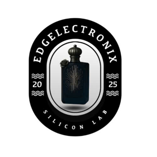

# S.C.E.N.T

**Smart Customer Experience & Edge AIoT for Inventory & Threats**
A perfume shelf that recommends a fragrance for *you*, notices when a bottle leaves the shelf,
and hears one break, with the AI running on the microcontrollers inside it.

 

> [!NOTE]
> Team **Edgelectronix**, FPT IoT Challenge 2025 (*AI for Smart Retail*, with Silicon Labs), May to
> September 2025. **Second Prize** at the final. This repo is a **showcase**; the firmware, gateway and
> dashboard source are private.

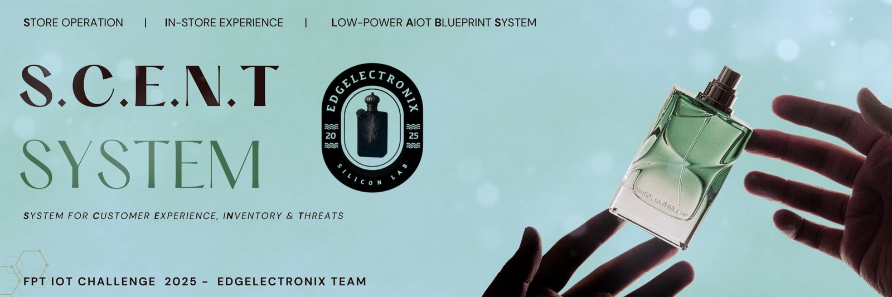

 

## 🏆 Result

### **Second Prize**, FPT IoT Challenge 2025 ✅

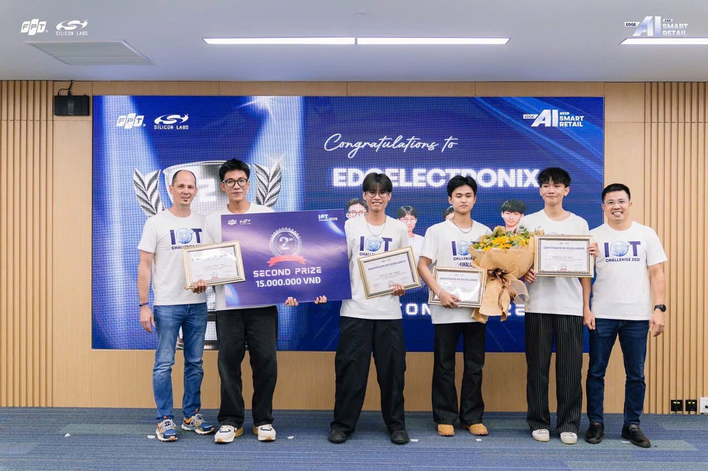

<table>
<tr>
<td width="50%" align="center">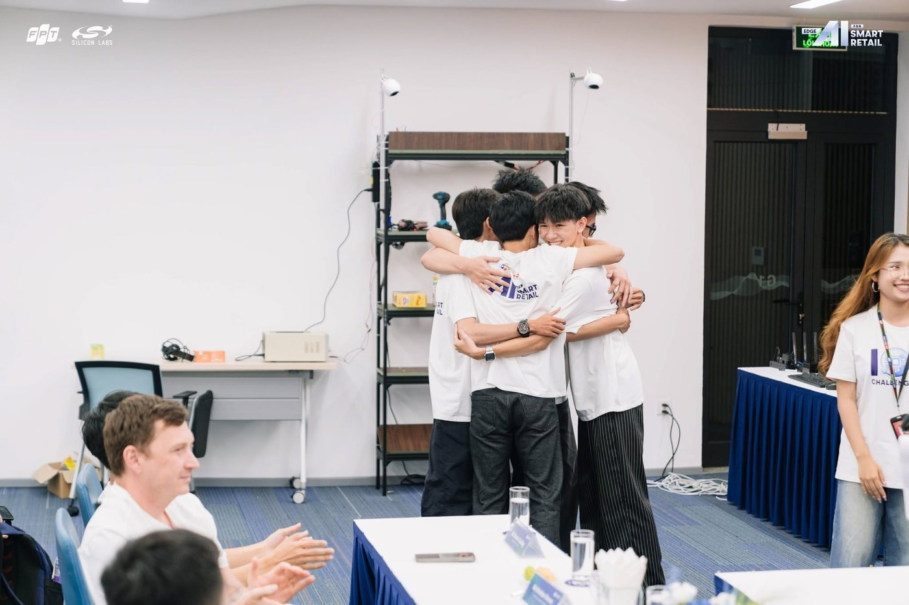 Pitching S.C.E.N.T at the final</td>
<td width="50%" align="center">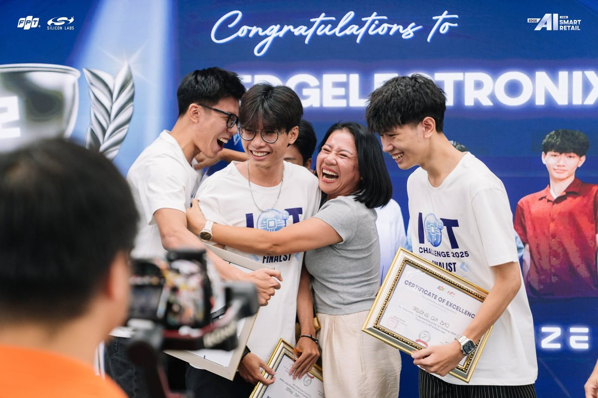 Right after the result</td>
</tr>
</table>

> *"We joined thinking it would be one more line on our CVs. The deeper we got, the more the
> competition pulled us in."* (the team, in FPT's announcement)

 

## 🌸 The problem

Walk into a perfume store and you're on your own: dozens of bottles, notes you can't smell from the
label, and a sales assistant who may or may not be free. The store has its own blind spots: which
bottles are actually being picked up, when a facing runs empty, and what happens when a glass bottle
hits the floor.

S.C.E.N.T turns a regular shelf into one that helps on both sides:

| For the customer | For the store |
| :--- | :--- |
| **A recommendation** from their personality, occasion and taste, with the matching bottle lighting up | **Live stock**: load cells and IR beams see each product leave the shelf |
| **Product info** on a touch screen at the shelf | **A drop alarm**: an on-device sound model hears a bottle break |
| **A voice or text chat** about what they're looking for | **Data** on what customers pick up, ask for and choose |

 

## 👥 Team

| | Who | What |
| :--- | :--- | :--- |
| 🖥️ | **Đặng Như Phước** | System architecture, Raspberry Pi gateway and Thread border router, the admin dashboard and the shelf's touch screen, the load-cell and IR sensor firmware |
| 🌸 | **Trương Gia Bảo** (me) | The perfume recommendation model on the EFR32xG24: dataset and features, a classifier and then an embedding model, INT8 deployment, UART link to the Pi |
| 🔊 | **Huỳnh Trọng Khiêm** | The drop-detection sound model on the EFR32xG26: dataset recording and augmentation, model, Micrium OS firmware |
| 🔌 | **Hồ Minh Thao** | Hardware |

Mentor: **Nguyễn Trung Hiếu**

 

## 🏗️ How the shelf works

Five pieces of hardware, one Thread mesh.

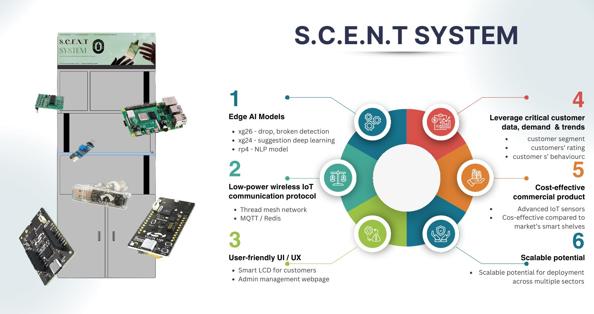

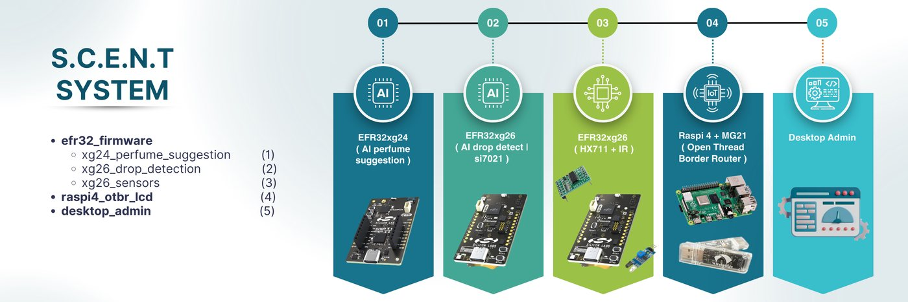

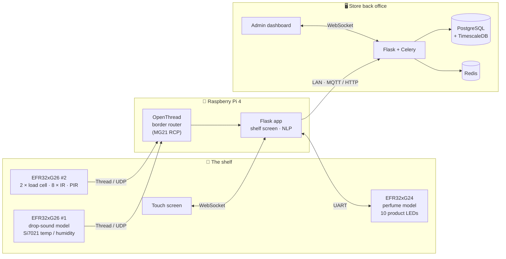

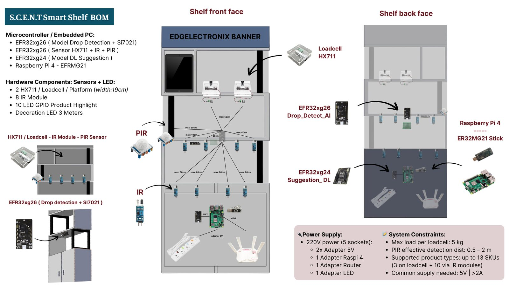

| Part | Count | Role |
| :--- | :---: | :--- |
| **EFR32xG24** dev kit | 1 | Perfume recommendation model, lights the product LED |
| **EFR32xG26** dev kit | 2 | #1: drop-sound model + Si7021 · #2: load cells, IR and PIR |
| **EFR32MG21** USB stick | 1 | Radio (RCP) for the Pi's Thread border router |
| **Raspberry Pi 4** | 1 | Thread border router, shelf screen, local NLP |
| **HX711 + load cell** | 2 | Product platforms, 19 cm wide, up to 5 kg each |
| **IR modules** | 8 | One per product facing |
| **PIR** | 1 | A customer is standing at the shelf |
| **Product LEDs** | 10 | Light up the recommended bottle |

 

## 🌸 Recommending a perfume, on a microcontroller

*My part of the project.*

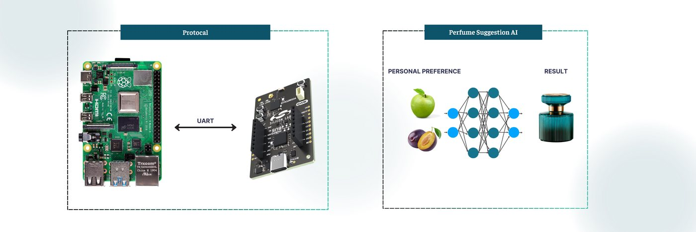

The customer tells the shelf what they like, by voice or on the screen. The Pi turns that into a
compact preference line and sends it over UART to the **EFR32xG24**, which runs the model locally and
lights the LED under the best match.

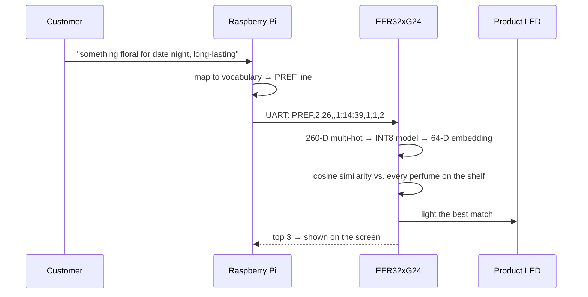

### First try: pick one of 50

The first model was a straight classifier, trained and profiled with Silicon Labs **MLTK**:

- **74 inputs**: age, 42 scent accords (citrus, vanilla, woody, leather…), gender, 9 personality types
  (bold, classic, romantic…), 10 occasions (work, date night, gym…), and preferred sillage, longevity
  and price
- **74 → 32 → 16 → 50**, fully connected, INT8: **10.4 KB**, **3.7k MACs**, **2 KB of RAM**
- **98.0 % average ROC AUC**, but only **66 % top-1 accuracy**, and 11 of the 50 perfumes were never
  predicted at all

The ranking was good, the single answer wasn't. With 50 classes and a handful of overlapping
preferences, several perfumes are legitimately right for the same person.

### What shipped: an embedding you can search

So the model stopped picking a class and started **describing** a perfume:

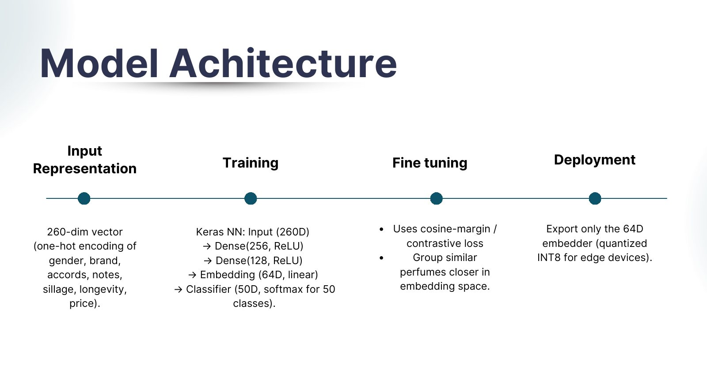

- Each perfume's DNA (gender, brand, top / middle / base notes, main accords, sillage, longevity,
  price) becomes a **260-D multi-hot vector**: 3 genders, 40 brands, 164 notes, 42 accords
- A small network, **260 → 256 → 128 → 64**, is trained as a classifier first, then fine-tuned with a
  **contrastive loss** on L2-normalised embeddings, so the same perfume's variations land close
  together (cosine ≈ 1) and different perfumes stay apart (< 0.2)
- Only the **embedding** part is exported, full INT8 with a calibration set, along with the
  catalogue's precomputed 64-D embeddings as C headers
- On the device: preference → embedding → **cosine similarity against every perfume** → a ranked top
  3. Adding a perfume to the shelf is one more row in the catalogue, not a retrained classifier

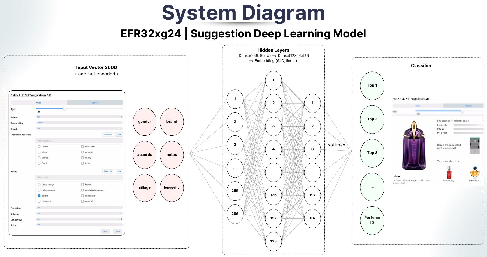

 

## 🔊 Hearing a bottle break

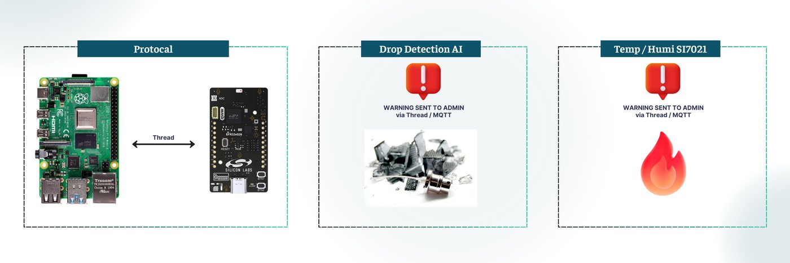

The first **EFR32xG26** listens through its on-board microphone for one sound: a glass perfume bottle
hitting a tile floor.

- **Model**: a temporal-convolution keyword-spotting network from MLTK, retrained for two classes,
  **drop** and **unknown**
- **Data**: about **4,500** recorded drops, against **10,500+** "unknown" clips (claps, mixed
  background, other objects colliding) so a clap doesn't set it off. 1 s clips at 32 kHz, augmented
- **Front end**: 96-channel filterbank from 100 Hz to 16 kHz, with noise reduction and a DC notch
  filter, because the dev board's microphone is noisy at low frequencies
- **Firmware**: three **Micrium OS** tasks and a queue. One records and runs the model continuously,
  one reads the **Si7021** temperature and humidity every 5 s, one owns the Thread stack and sends
  whatever lands in the queue

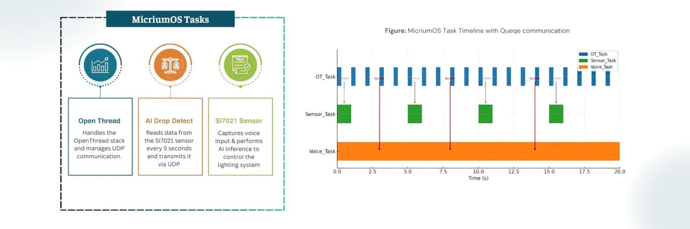

 

## 📦 Knowing what left the shelf

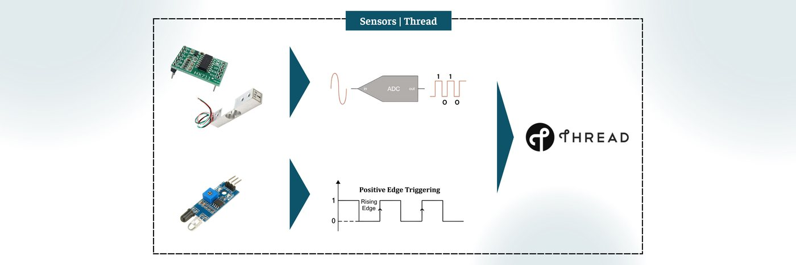

The second **EFR32xG26** watches the products:

- **8 IR beams**, one per facing, on GPIO interrupts with a 500 ms debounce. A break sends that
  product's code (`P001`, `P045`…)
- **2 load-cell platforms** read through HX711s every 500 ms. A drop of **100 g or more** means a
  bottle was lifted
- A **PIR** sensor says someone is standing at the shelf
- Each event goes out as a small **UDP packet over Thread** to the Pi

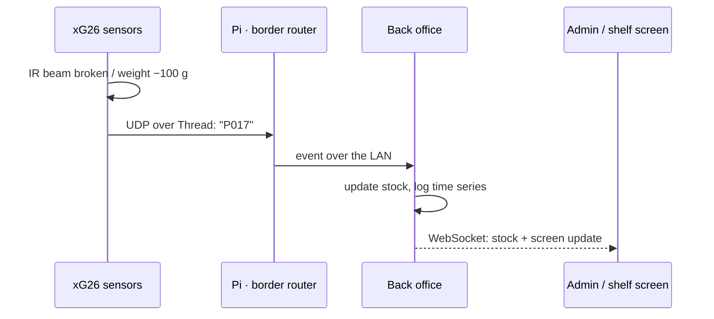

 

## 🖥️ Gateway and back office

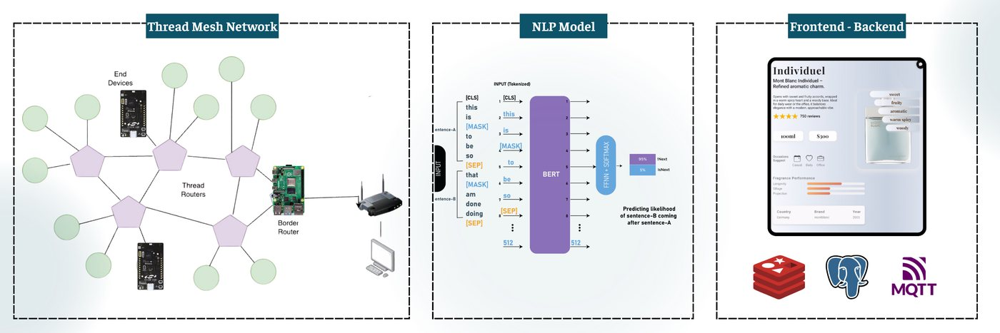

- **Raspberry Pi 4**: the **OpenThread border router** (leader of the shelf's Thread mesh, with an
  MG21 USB stick as its radio), the shelf's touch-screen app, and the heavier local models: a
  **BERT-style NLP model** that pulls intent and preferences out of what the customer says
- **Back office**: Flask + Celery, **PostgreSQL with TimescaleDB** for sensor time series, Redis and
  MQTT for realtime events, and a web dashboard for stock, drop alerts and customer insight

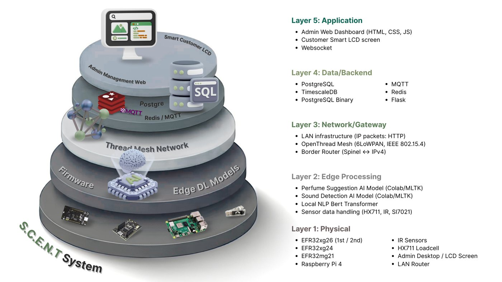

 

## 🧰 Stack

| Layer | Stack |
| :--- | :--- |
| **Edge AI** | Silicon Labs MLTK, TensorFlow / Keras, contrastive embeddings, TensorFlow Lite Micro (INT8) |
| **Firmware** | Simplicity Studio 5, C, OpenThread, Micrium OS, HX711 / IR / PIR / Si7021 drivers |
| **Network** | Thread mesh (IEEE 802.15.4, 6LoWPAN), OpenThread Border Router on an MG21 RCP, UDP, LAN |
| **Gateway** | Raspberry Pi 4, Flask, WebSocket, local NLP |
| **Back office** | Flask, Celery, PostgreSQL + TimescaleDB, Redis, MQTT, HTML / CSS / JS |

 

| 🏆 Second Prize | 🧠 2 on-device models | 📡 1 Thread mesh | 🧴 13 products |
| :---: | :---: | :---: | :---: |
| **4** Silicon Labs boards | **10.4 KB** first model | **260 → 64** embedding | **~15k** audio clips |

 

---

**[Bảo Trương](https://github.com/baotrq)** · with Đặng Như Phước, Huỳnh Trọng Khiêm and Hồ Minh Thao · Team Edgelectronix · FPT IoT Challenge 2025

